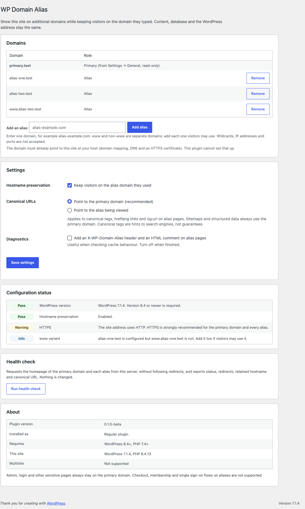
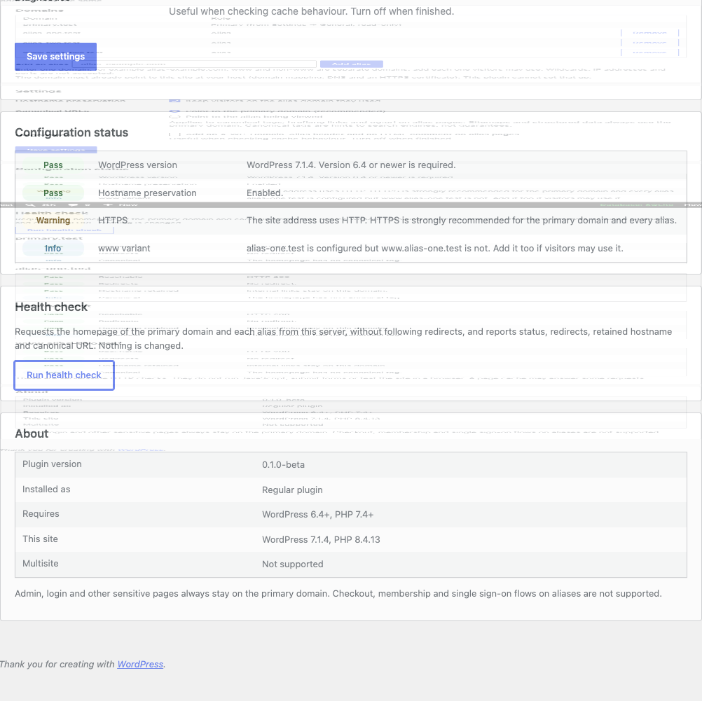
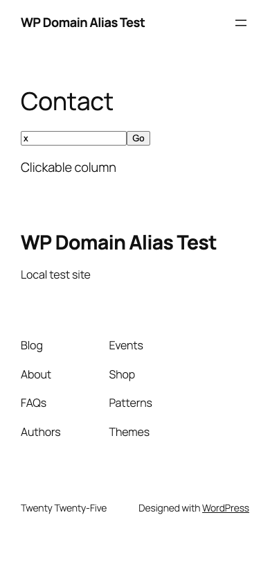

# WP Domain Alias

Show one WordPress site on several approved domains while keeping visitors on the domain they typed. Canonical URLs, sitemaps and structured data keep pointing at the primary domain.

> **Current release: 0.1.1.** Tested locally only, on PHP's built-in server and on Nginx and Apache with PHP-FPM over HTTPS (see [what was tested](#what-has-been-tested)). No hosting provider has been tested yet. Try it on a staging copy first.

## What it does

Suppose your site lives at `primary-example.com`, and `alias-example.com` also points to the same WordPress installation. Without this plugin, every menu link, button and form on `alias-example.com` sends visitors to `primary-example.com`. With it:

- Navigation links, buttons, pagination, forms and language switchers on an alias keep the alias hostname.
- Canonical tags (by default), sitemaps and JSON-LD stay on the primary domain, so search engines see one site.
- Admin, login, sign-up, cron and XML-RPC always stay on the primary domain.
- Only domains an administrator adds are used. Requests with any other `Host` header are not treated as aliases.
- A health check shows whether each domain answers, redirects, keeps its hostname, and has the expected canonical URL.

What it does **not** do:

- It does not change the database, run search-replace, or touch the WordPress Address / Site Address settings.
- It does not create DNS records, hosting domain mappings, virtual hosts or SSL certificates. You set those up at your host first.
- It makes no outgoing requests except the health check that an admin starts. There is no telemetry, licensing or remote service.

## When to use it — and when not to

| You want… | Use |
|---|---|
| Several domains to show the **same** site, each keeping its own hostname | **WP Domain Alias** |
| Old domains to send visitors to one main domain | A 301 redirect at your host or CDN (no plugin needed) |
| Separate sites, each with its own content, users or settings | WordPress Multisite (not supported by this plugin) |
| Checkout, membership or single sign-on on each domain | Not supported. Keep those flows on the primary domain. |

## Requirements

- WordPress 6.4 or newer (tested on 6.4.5 and 7.1.4)
- PHP 7.4 or newer (tested on PHP 8.4)
- A single-site installation. Multisite is not supported.
- Each alias must already reach this WordPress installation, ideally over HTTPS with a valid certificate.

## DNS and hosting prerequisites (do this first)

**Every domain must resolve and route to the same WordPress installation before this plugin can work.** Add the primary domain and every alias (including any `www` hostnames you plan to use) in your hosting provider's domain list.

- **A records:** If your hosting provider assigns an IPv4 address, point each root/apex domain's A record to that **same hosting-assigned IP address**. Any AAAA records must also route to the same installation.
- **CNAME or managed-host targets:** Some providers require a CNAME or a different DNS target instead of a shared A record. Follow the host's instructions. The real requirement is that all domains reach **the same WordPress installation**.
- **HTTPS:** Verify valid SSL/TLS certificates for every hostname and that your host/CDN does not redirect approved aliases to the primary hostname.
- **WordPress settings:** Keep **Settings → General → WordPress Address (URL)** and **Site Address (URL)** on the primary domain.

Wait for DNS propagation and verify each domain reaches the same site. The plugin cannot provision DNS, hosting aliases or certificates. See [hosting guides](docs/hosting/README.md).

## Installation

1. Complete the [DNS and hosting prerequisites](#dns-and-hosting-prerequisites-do-this-first) for every alias first.
2. Download `wp-domain-alias-<version>.zip` from the [Releases](../../releases) page.
3. In WordPress go to **Plugins → Add New → Upload Plugin**, choose the ZIP, install and activate.
4. Go to **Settings → WP Domain Alias**, add each alias (add `www.` and non-`www` forms separately if both are used).
5. Click **Run health check**.
6. Purge your page cache, then visit each alias and click through menus, forms and any language switcher.

A Must-Use installation is available for advanced users: [docs/must-use.md](docs/must-use.md).

Step-by-step guides: [docs/installation.md](docs/installation.md).

## Settings

| Setting | Default | What it does |
|---|---|---|
| Aliases | none | Exact hostnames, up to 25. Wildcards, IP addresses, ports and paths are rejected. Internationalised domains are stored as punycode. |
| Hostname preservation | on | Off = aliases still load, but links point to the primary domain. |
| Canonical URLs | primary | Always the primary domain: canonical, hreflang and `og:url` on alias pages point to the primary domain. Not configurable (see [SEO](#seo)). |
| Diagnostics | off | Adds an `X-WP-Domain-Alias` response header and an HTML comment on alias pages, to help debug caching. |

The primary domain is read from **Settings → General → Site Address** and cannot be changed here.

## Health check

The health check runs only when an administrator clicks the button. It requests each saved domain's homepage from the server, without following redirects, with a 5-second timeout and a 1 MB response limit.

- **Short requests.** With JavaScript, one domain is checked per request and results appear as they arrive. Without JavaScript, up to three domains are checked per click, with a **Check the next domains** button. No request runs long, even with 25 aliases.
- **Safe destinations.** Every address a domain resolves to must be public. The connection is pinned to the checked address, so a second DNS answer can't redirect it.
- **Rate limit.** A new check can be started once every 20 seconds per user.

It reports:

- whether the domain answers with HTTP 200 and a valid certificate,
- any redirect, and whether it goes to another domain,
- whether internal links keep the alias hostname (a cache serving another domain's copy shows up here),
- the canonical URL and whether it points to the primary domain.

It does not run JavaScript, submit forms or test the site in a browser.

## How it works

WordPress keeps generating primary-domain URLs. On an approved alias page view, the plugin:

1. buffers the final HTML and changes only navigation attributes (`a`/`area` `href`, `form action`, `formaction`, `data-column-clickable`) that point to this site, using WordPress's HTML API (`WP_HTML_Tag_Processor`);
2. serves scripts, stylesheets, the script-module import map and theme fonts from the alias, because browsers block module scripts and web fonts loaded from another origin without CORS headers (images stay on the primary domain);
3. keeps REST API and `admin-ajax.php` requests made by frontend scripts on the alias, so forms and AJAX stay same-origin (`admin-post.php` forms stay on the primary unless a site [opts them in](#developer-filters));
4. keeps WordPress's own canonical redirects (trailing slash, etc.) on the alias, and cancels only redirects that would switch the visitor to another host.

Details: [docs/architecture.md](docs/architecture.md).

## SEO

- Every alias page has one canonical tag pointing to the same page on the primary domain. Hreflang alternates and `og:url` do too. XML sitemaps (core, Yoast SEO, Rank Math) and JSON-LD list only primary URLs.
- Canonical tags are hints that search engines usually follow, not guarantees.
- 0.1.0-beta had an option to point canonicals at the alias. It sent contradictory signals and was removed in 0.1.1-beta. A stored value is migrated automatically, with a one-time notice.

More: [docs/seo.md](docs/seo.md).

## Caching

Your page cache and CDN must store a separate copy per hostname. Most do by default. A cache keyed only on the path would show one domain's links on another. The health check detects this. Purge all caches after adding or removing an alias.

Cache Enabler is supported directly: purges are repeated for each alias. An Nginx FastCGI cache keyed on the host was also verified. Details, test results and per-cache notes: [docs/caching.md](docs/caching.md).

## What has been tested

All testing was done locally with `.test` hostnames. **No hosting provider has been tested.**

| Area | Tested with |
|---|---|
| Servers | PHP 8.4 built-in server (HTTP); Nginx 1.31.8 + PHP-FPM 8.4 (HTTPS); Apache 2.4.67 + PHP-FPM 8.4 with `.htaccess` rewrites (HTTPS) |
| WordPress | 6.4.5 and 7.1.4 (Twenty Twenty-Four, Twenty Twenty-Five) |
| SEO | WordPress core, Yoast SEO 28.8, Rank Math 1.0.281 |
| Multilingual | Polylang 3.9.1 |
| Builders and forms | Elementor 4.3.6, Contact Form 7 6.2.4.1 |
| Cache | Cache Enabler 1.8.17; Nginx FastCGI cache (host key, plus a path-only key as a negative control); simulated proxy caches |
| Browser | Chrome via Playwright, desktop and 390×844 mobile |

Not tested: Gravity Forms (needs a licence), Weglot (needs an account; its integration is unit-tested with stubs only), WPML, WooCommerce, WP Rocket, LiteSpeed Cache, W3 Total Cache, WP Super Cache (tried, could not be verified), LiteSpeed/OpenLiteSpeed servers, any CDN, and all hosting providers.

Full matrix: [docs/compatibility.md](docs/compatibility.md). Hosting: [docs/hosting/README.md](docs/hosting/README.md). How to run the tests: [docs/testing.md](docs/testing.md).

## Known limitations

- **Multisite** is not supported. The plugin refuses network activation and does nothing on a network.
- **Logged-in sessions** are per domain. Admin and login stay on the primary domain, so logged-in features on alias pages (admin bar, comment forms for logged-in users) behave as for a logged-out visitor.
- **Checkout, membership, SSO and OAuth** flows on aliases are not supported. Use the `wp_domain_alias_rewrite_url` filter to keep such URLs on the primary domain.
- **`admin-post.php` forms** post to the primary domain by default, so visitors land on the primary domain after submitting. Specific actions can be kept on the alias with the `wp_domain_alias_admin_post_actions` filter, if their handler doesn't rely on primary-domain cookies.
- **Page caches keyed only by path** are not supported.
- **WordPress below 6.7**: font URLs that other plugins print inline in `<style>` tags are not adjusted. Theme and Font Library fonts are.
- **Per-domain SEO** (alias canonicals, per-domain sitemaps or structured data) is not provided. Use separate sites if each domain must rank on its own.
- **The www/non-www form of the primary domain** is usually redirected by the host before WordPress runs. The plugin cannot override that.
- **Health-check DNS pinning** needs WordPress's cURL transport (the default when the cURL extension is loaded). DNS lookup time is not limited by the 5-second timeout.
- **Hosting providers**: none tested yet. Nginx and Apache were verified locally; the provider guides are based on documented features and must be verified.

## Troubleshooting

See [docs/troubleshooting.md](docs/troubleshooting.md). Quick checks:

- **Alias redirects to the primary domain**: a redirect rule at the host, CDN or a redirect plugin. The health check shows where it goes.
- **Links on an alias point to another domain**: a page cache served another domain's copy. Purge and check the cache key includes the host.
- **Fonts or the mobile menu broken on an alias**: an optimisation plugin or CDN is rewriting asset URLs. See [docs/caching.md](docs/caching.md#fonts-and-cors).

## Developer filters

| Filter | Purpose |
|---|---|
| `wp_domain_alias_aliases` | Modify the alias list (results are validated again). |
| `wp_domain_alias_rewrite_url` | Return `false` to keep a specific URL on its original host. |
| `wp_domain_alias_url_attributes` | Change which HTML attributes count as navigation URLs. |
| `wp_domain_alias_same_origin_assets` | Return `false` to leave scripts, styles and fonts on the primary domain. |
| `wp_domain_alias_buffer_output` | Return `false` to skip the HTML pass for a request. |
| `wp_domain_alias_admin_post_actions` | List `admin-post.php` actions whose frontend forms (and the redirect after them) stay on the alias. Default: none. |
| `wp_domain_alias_health_check_ips` | Supply the addresses the health check uses for a host instead of resolving DNS (they are still validated). |

## Security

See [SECURITY.md](SECURITY.md) for how to report a vulnerability, and [docs/security-review.md](docs/security-review.md) for the threat model and review notes.

## Contributing

See [CONTRIBUTING.md](CONTRIBUTING.md).

## License

GPL-2.0-or-later. See [LICENSE](LICENSE).
